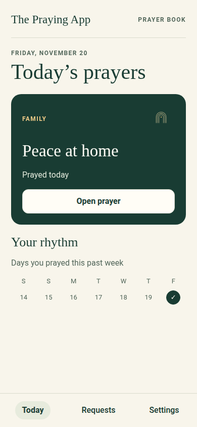
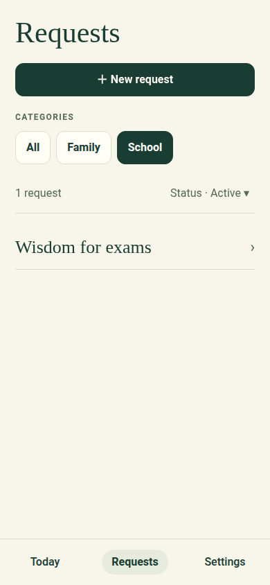

# The Praying App

An offline-first prayer book for Android and iOS. Capture prayer requests, organize them by category, and mark when you pray or when a prayer is answered. Set a daily reminder and see the days you prayed this week.

<p>
  
  
</p>

*Mobile-width browser previews with sample prayers.*

## Run locally

Use Node.js 24 and npm.

```sh
npm ci
npm start
```

Open an Android or iOS development build from Expo. Use `npm run android` with the Android SDK and an emulator or connected device. Use `npm run ios` on macOS with Xcode. For a browser preview, run `npm run web`. Daily device reminders are available in the native apps.

Guest mode works without an account or environment file. To connect an existing prayer portal, copy `.env.example` to `.env` and fill in the Supabase project URL and a publishable or legacy anon key. Expo embeds these values into the app bundle. Use the portal migrations for `portal_categories`, `portal_prayer_requests`, and `portal_prayer_logs`, including their row-level access policies. A live portal connection is required for account sign-in and sync.

## Design and implementation

- **Categories come first.** A scrollable row gives each category a one-tap filter. The status control sits beside the request count and applies within the selected category.
- **Prayer history follows the device calendar.** Users can log one prayer per request per day. The Today screen uses the last seven local dates to show their prayer rhythm.
- **Local writes come before network requests.** The native app stores each book and its pending writes together in SQLite. A signed-in account has a separate book from the guest book, and users choose when to import guest prayers.
- **Sync retries while the app is in use.** It runs on launch, on foregrounding, once a minute while active, and on demand. Stable record IDs let the app retry inserts without duplicating them. The server’s row-level policies govern access to each account’s prayers.
- **The UI adapts to the platform.** Expo Router powers navigation. iOS uses native tabs and Liquid Glass controls where supported, with an opaque fallback for Reduce Transparency and older versions.

## Verification

```sh
npm run lint
npx tsc --noEmit
```

A fresh checkout was tested in the browser without an environment file. Guest startup, request creation, prayer logging, and category filtering all passed. The Android reminder was also tested through notification delivery. The iOS simulator build has compiled, and the repository includes a [Maestro flow](.maestro/prayer.yaml) to run on an iOS simulator.

To test sign-in, account isolation, and sync retries, start a disposable local Supabase instance with the portal migrations and email confirmation disabled. Run [the integration test](tests/sync.mjs) using its client key.

```sh
TEST_SUPABASE_ANON_KEY=<local-anon-key> node tests/sync.mjs
```

## Build profiles

| Profile | Output |
| --- | --- |
| `preview` | Installable Android APK |
| `production` | Android App Bundle or signed iOS release with distribution credentials |
| `simulator` | iOS Simulator build |
| `device-archive` | Unsigned iOS device archive for the publisher |

Run `npx eas-cli@latest build --platform android --profile preview` for an Android preview build. If you fork the app, configure an EAS project you own. The existing app identifier is retained for upgrades from earlier builds. Store releases require a reachable production backend for live sync and Apple distribution credentials for iOS.
